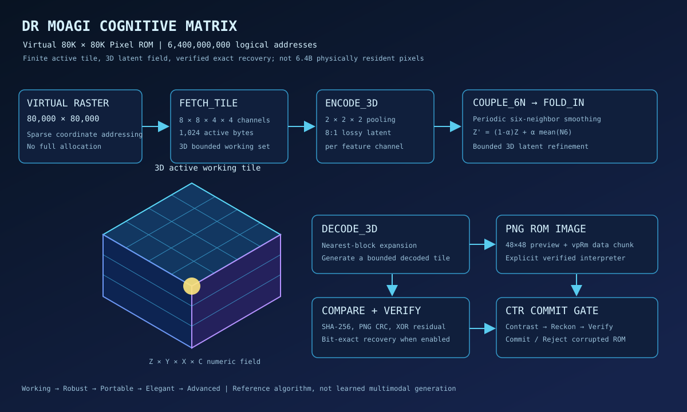

# Dr Moagi Virtual 80K × 80K Pixel Image ROM

This is a **bounded, executable reference** for a virtual raster of
**80,000 × 80,000 = 6,400,000,000** addressable pixel positions. The accompanying
PNG is a normal viewable image containing a versioned **data-only** ROM manifest
in a private PNG ancillary chunk (`vpRm`). An explicit, trusted Python interpreter
reads the manifest, reconstructs a 3D tile and verifies its bytes.

The existing [sparse 3D reference](../src/jarvisx/dr_moagi_virtual_3d_ae.py)
addresses virtual 3D positions. This image ROM is a separate **2D virtual raster
with bounded 3D working tiles** of shape `(depth=4, tile, tile, channels=4)`.
These feature channels are synthetic numerical proxies; no real text-to-image,
audio synthesis, MP4 codec or trained intelligence is implied.

## Architectural mapping

### Execution pipeline

    80,000 × 80,000 virtual XY addresses (6.4 billion; no dense allocation)
       |
       +--> FETCH_TILE(x_tile,y_tile): deterministic 3D feature data
       |      four depth slices × four numeric feature channels
       +--> ENCODE_3D: mean pooling over 2×2×2 voxels
       +--> COUPLE_6N / FOLD_IN: periodic six-neighbor refinement
       +--> DECODE_3D: nearest-block expansion
       +--> COMPARE: reconstruction MSE
       +--> VERIFY: optional bytewise XOR residual and SHA-256
       +--> COMMIT: publish bounded tile inside a PNG

### Algebra

For each feature channel c, 3D block coordinate q, and active voxel field X:

\[
Z_{\mathbf q,c}=\left\lfloor\frac{1}{8}
\sum_{\delta\in\{0,1\}^3} X_{2\mathbf q+\delta,c}
+\frac12\right\rfloor.
\]

An integer-stable geometric smoothing step implements

\[
Z'_{\mathbf q,c}=\operatorname{round}
\left[(1-\alpha)Z_{\mathbf q,c}+
\frac{\alpha}{6}\sum_{u\in N_6(\mathbf q)} Z_{u,c}\right],
\qquad \alpha=1/4,
\]

with **tile-local periodic** neighbors. Decoder X-hat copies the
latent values into their corresponding eight voxels. Unless `--lossy` is
selected, the PNG stores the XOR residual R = X XOR X-hat and SHA-256 of
the original tile. The decoder reconstructs X = X-hat XOR R and checks
the digest.

This executes a finite mathematical program, **not** a trained neural
autoencoder, an FFT SPD solver, or a self-improving cognitive model.
The PNG `instructions` entry is an allowlisted data *description*, not
native executable machine code.

## Run

    python -m jarvisx.virtual_80k_image_rom build --tile 8 \
      --tile-x 1 --tile-y 2 --out virtual_rom.png
    python -m jarvisx.virtual_80k_image_rom inspect --input virtual_rom.png
    python -m jarvisx.virtual_80k_image_rom verify --input virtual_rom.png
    python -m jarvisx.virtual_80k_image_rom extract --input virtual_rom.png \
      --out recovered_tile.rgba
    python -m pytest -q tests/test_virtual_80k_image_rom.py

Open the PNG in an ordinary image viewer for its 48×48 preview. Run the
Python command **explicitly** to execute the decoder. Opening an image
does not and should not execute arbitrary code.

## Resource boundaries and security

- Dense RGBA8 storage for all virtual pixels costs 25.6 billion bytes
  (approximately 23.84 GiB); 3D feature depth is likewise not densely allocated.
- The default active tile is 8×8×4×4 = 1,024 source bytes, plus overhead.
- Tile width must be even, at most 128, and divide 80,000.
- PNG and ROM payloads have explicit size caps. PNG CRC is checked;
  lossless recovery checks SHA-256 of the decoded tile.
- The internal SHA-256 is **not authentication**: a malicious editor
  could rewrite the PNG and recompute it. Use a trusted external
  signature or artifact digest for adversarial workflows.
- Independent tile-local periodic refinement does not reproduce a
  single global spatial operator without boundary exchange.
- The PNG encodes a deterministic synthetic tile, **not** real
  text/audio/video generation or all 6.4 billion pixel values.

Future work: real modality adapters, globally coupled 3D refinement,
learned decoders, integrity and resource budgets, and a CTR
(Contrast → Reckon → Verify → Commit/Rollback) promotion gate.

Python 3.10+ and standard library only. No dense 80K image allocation
or exponential hardware speedup is claimed.
