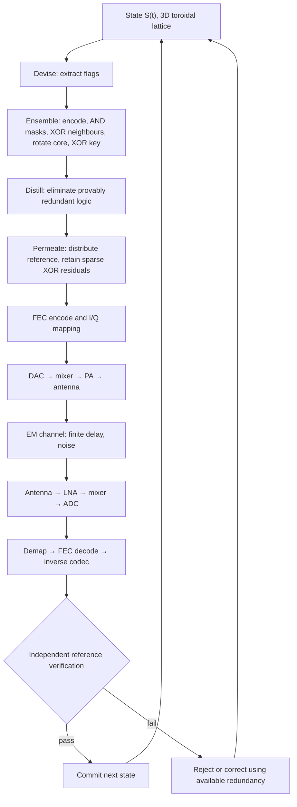

# JARVIS-X Ω³ — recursive electromagnetic intelligence media processor

Status: proposed mixed-signal architecture; executable digital reference, not fabricated hardware. Extends [inward permeation](DR_MOAGI_1000_CUBED_INWARD_PERMEATION.md) and [intelligence media processor](DR_MOAGI_INTELLIGENCE_MEDIA_PROCESSOR.md). This document does not replace existing ISA assignments.

## Operational logic



For i=(x,y,z) in (Z/LZ)^3, with six periodic neighbours, snapshot all states before updating:
```
Z_i = E(S_i)
U_i = Z_i XOR XOR_j(Z_j AND M_ij) XOR ROTL(Z_core,r_P) XOR K_t
S_next_i = D(U_i) XOR Delta_i
```
Reference specialization: E=ROTL64(7), D=ROTR64(7), 64-bit unsigned words. These are bijections but do not compress arbitrary inputs. The full coupled global map is not proven invertible or contractive. Fixed masks yield affine binary aggregation; learned masks or other nonlinear operators are a separate ANN extension. XOR key modulation is not authenticated encryption.

## Invariant and physical boundary

For a known basis z*, residual e_i = S_i XOR z*. Preserve e_i before replacing S_i with z*. Reconstruct S_i = z* XOR e_i. The projection P_z(S_i)=S_i XOR (S_i XOR z*) is idempotent: P_z^n=P_z for n>=1. This removes redundant logical operations, not the physical cost of distributing the reference. Logical addresses are still necessary to recover heterogeneous residuals. Zero pairwise Hamming discrepancy is not proof of external correctness.

On an L=1000 torus, one-hop synchronous delivery from a single seed takes up to 1500 rounds. One 64-bit state per voxel requires 8 GB decimal; double buffering alone requires 16 GB. These are derived quantities, not benchmarks. Six independently delivered 64-bit words per voxel imply 384 Gbit of logical directed traffic per full update, before coding overhead.

Physical mappings: bits → voltage thresholds → Boolean gates → registers; TX: FEC → modulation → DAC → mixer → PA → antenna; RX: antenna → LNA → mixer → ADC → demap → FEC. For BPSK, chi(b)=(-1)^b; chi(a XOR b)=chi(a)chi(b), requiring multiplication/regeneration rather than passive interference alone. A shared logical state is not a superconducting bus. RF timing, clock recovery, BER, energy, hardware synthesis, security and real ANN training require separate tests. Correction must be based on independently available information, not an oracle at the receiver.

## Reproduction

Run from repository root with Node.js:

```sh
node reference/omega3_em_bitwise.mjs
```

Deterministic digital tests: all 256 payloads with no error or one of 12 single-bit errors (3328 total shortened Hamming(12,8) cases); 512 64-bit words with reversible rotation and residual recovery; six-neighbour seed propagation over 12 rounds; 1000 repeated projection iterations; 1000 checkerboard coupled-field iterations; one nonuniform masked update. Multi-bit errors are outside the Hamming correction guarantee. The propagation model uses a separate valid/reachability mask, not instantaneous broadcasting.

Observed in the authoring execution: zero FEC, residual and projection mismatches. Reachability: 1,7,25,63,126,210,302,386,449,487,505,511,512. Checkerboard remains unchanged with two distinct words and 256 reference mismatches, refuting universal synchronization under XOR coupling. No physical RF tests performed.

## Acceptance gates

1. Bit-exact reversible local codec and residual reconstruction.
2. Correct FEC for specified single-error model.
3. Explicit distinction between fixed point and global reference agreement.
4. Independent channel and hardware verification before any throughput or zero-error claims.
5. No automatic deployment or merge based solely on this digital reference.
