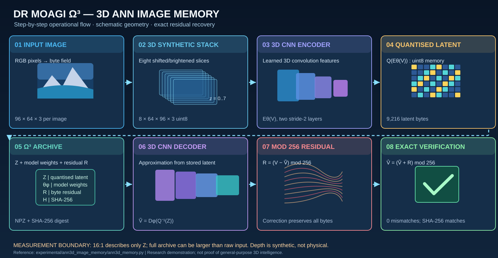
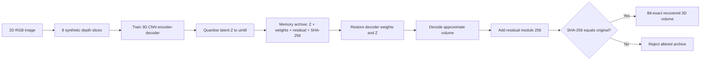

# Dr Moagi Ω³ — 3D ANN Image Memory (research demonstrator)

[Open the step-by-step image](STEP_BY_STEP.svg)

This experimental module trains an actual **3D convolutional neural autoencoder** on a small RGB volume, quantises its latent activations, stores model weights and exact modular residuals in a compressed NumPy archive, decodes the stored archive, and checks SHA-256 of the recovered bytes.

**Important:** with one 2D image the depth axis is deliberately *synthetic* (shifted/brightened slices). This is not recovered physical geometry or learned 3D scene understanding. The ANN prediction is lossy; exact reconstruction requires the residual, and the archive includes trained weights.

## Run

Python 3.10+, numpy, pillow, torch (CPU supported):

    python -m pip install numpy pillow torch
    cd experimental/ann3d_image_memory
    python ann3d_memory.py --steps 160
    python ann3d_memory.py --input /path/to/photo.png --archive out.npz --preview out.png
    python -m unittest discover -s . -p 'test_*.py' -v

No image is required; the script defaults to a reproducible procedural RGB image. Standard volume: 8 × 64 × 96 × 3 uint8 = **147,456 raw bytes**. Encoder: Conv3d(3,8,stride=2) followed by Conv3d(8,12,stride=2); latent: 1 × 12 × 2 × 16 × 24 uint8 = **9,216 bytes**. Decoder uses two matching ConvTranspose3d layers. The raw:latent tensor capacity ratio is **16:1**, excluding residual, weights and archive overhead.

## Execution

## Mathematics

Let V be a uint8[D,H,W,3] field; Eθ and Dφ the learned 3D CNN transforms; Q an 8-bit min-max quantiser; Z = Q(Eθ(V)); and Ṽ = round(255 Dφ(Q⁻¹(Z))).

- Residual: **R = (V − Ṽ) mod 256** (uint8).
- Exact inverse: **V̂ = (Ṽ + R) mod 256 = V** when decoder and arithmetic match.
- Integrity: SHA256(V bytes) is recorded and checked post-decode. Unkeyed SHA-256 does not authenticate a maliciously replaced archive.
- Training objective: mean squared *uncorrected* reconstruction error. The correction stream is calculated only after training.

The script reports actual archive bytes (model + quantised latent + residual + container overhead), pre-correction MSE and post-correction mismatches. **A 16:1 latent ratio is not an end-to-end compression benchmark.**

## Local measured demonstration (2026-11-16)

For the procedural volume trained for **8** optimisation steps:
- Raw data: 147,456 bytes; quantised latent: 9,216 bytes.
- Full saved archive: **195,076 bytes** (larger than uncompressed raw data).
- MSE before residual: **4,273.26** (8 training steps).
- Mismatched channels after residual: **0**.
- Five focused CPU unit tests passed, including deliberate residual modification detection.

These local metrics are not guaranteed to match across every hardware / package configuration.

## Validation boundaries

Tests cover byte-exact round trip, decoded tensor shape, latent size, checksum rejection and bad dimensions. This is a bounded single-volume proof of operation, not an autonomous optimizer, generalization study or meaningful volumetric depth estimator. Read only locally trusted .npz files; the loader is not designed for adversarial remote submissions. Scope is isolated to this new experimental directory. No core runtime is replaced.

Provenance: this is an implementation of the **user-proposed Dr Moagi Ω³** research architecture, not a verified claim of independent novelty or superhuman intelligence.
